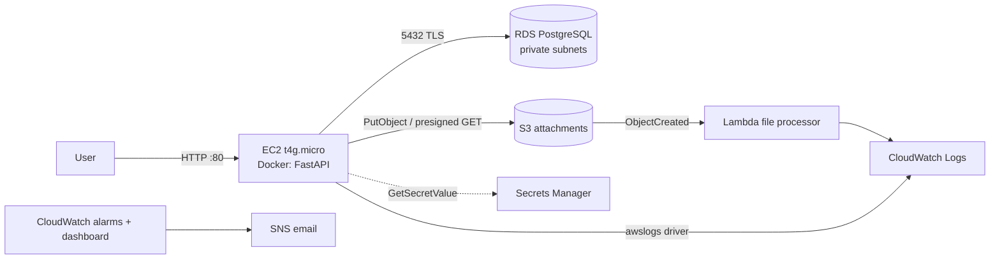

# Architecture

| Layer | Detail |
|---|---|
| VPC 10.0.0.0/16 | 2 public subnets (EC2), 2 private subnets (RDS, no internet route), S3 gateway endpoint, no NAT |
| Security groups | app: 80 in, 443 + 5432-to-db out; db: 5432 from app SG only |
| Secrets | RDS-managed master secret; `ticketdesk-poc/app` (seed passwords, session key) |
| Deploy path | Image → ECR → SSM Run Command → `/opt/ticketdesk/deploy.sh` on EC2 (idempotent; container restarts on reboot) |
