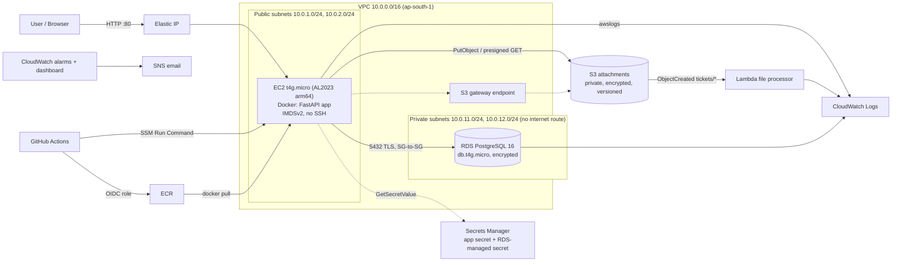
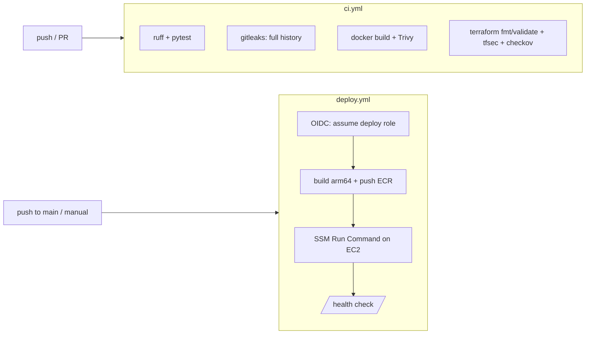

# Project TicketDesk – Engineer POC Document

| | |
|---|---|
| **Participant** | Prashant Soni (individual execution) |
| **Stream** | Python (FastAPI) |
| **Repository** | https://github.com/Prashant-Soni007/ticketdesk-poc |
| **Live application** | http://13.203.87.250 (ap-south-1) |
| **Region / prefix** | ap-south-1 (Mumbai) / `ticketdesk-poc` |

Evidence for every statement lives in [`docs/evidence/`](evidence/) (file numbers in brackets, e.g. [112]). Problems and fixes: [`docs/problems.md`](problems.md).

---

## 1. Project overview
TicketDesk is a lightweight IT-support ticket tracker: users log in, raise tickets with attachments, and follow them through **Open → In Progress → Resolved → Closed**; admins move tickets through that flow and see a dashboard across all tickets.

The POC deploys the application on AWS with Terraform and integrates managed services: **EC2** (Docker) for the app, **RDS PostgreSQL** for data, **S3** for attachments, **Lambda** for S3-triggered file processing, **Secrets Manager** for credentials, and **CloudWatch/SNS** for logs, alarms and a dashboard. CI/CD runs on GitHub Actions with keyless (OIDC) deployment.

The provided application source was not available for the Python stream, so a compatible FastAPI implementation with all six required features was written in `app/`.

| Feature (brief) | Implementation |
|---|---|
| User login | Session login, PBKDF2-hashed passwords, CSRF on every form |
| Create ticket | Title, details, priority |
| View tickets | List with status filter, detail page |
| Update status | Admin-only, one step forward at a time |
| Dashboard | Counts per status, status bar, recent tickets (+ JSON API) |
| File attachment | Upload to S3 (type/size limits), download via presigned URL |

## 2. Architecture diagram


## 3. AWS services used
59 Terraform-managed resources in the dev stack [110] plus the bootstrap state bucket.

| Service | Resources | Purpose |
|---|---|---|
| VPC | VPC, 4 subnets, IGW, 2 route tables, S3 gateway endpoint, locked default SG | Network isolation; DB tier without internet route; no NAT (cost) |
| EC2 | t4g.micro instance, Elastic IP, 2 security groups | Runs the Docker container; stable public IP |
| RDS | PostgreSQL 16.13 `db.t4g.micro`, subnet group | Managed database in private subnets |
| S3 | Attachments bucket (+ PAB, versioning, SSE, lifecycle, TLS-only policy); state bucket | File storage; Terraform remote state |
| Lambda | `ticketdesk-poc-file-processor` (python3.12, arm64) | Processes every uploaded attachment |
| ECR | `ticketdesk-poc-app` (immutable tags, scan on push) | Private container registry |
| Secrets Manager | `ticketdesk-poc/app`, RDS-managed `rds!db-…` | Seed passwords, session key, DB credentials |
| IAM | EC2 role, Lambda role, GitHub OIDC provider + deploy role | Least-privilege identities, keyless CI/CD |
| Systems Manager | Session Manager / Run Command | Deploys and access without SSH |
| CloudWatch | 3 log groups, metric filter, 6 alarms, dashboard | Logs, alerting, visibility |
| SNS | `ticketdesk-poc-alerts` + confirmed email subscription | Alarm notifications |

## 4. Application flow
1. **Login** – `POST /login` checks the PBKDF2 hash; the session cookie is signed with the session secret.
2. **Create ticket** – `POST /tickets` (CSRF-checked) stores the ticket in RDS with status *Open*.
3. **Attach file** – `POST /tickets/{id}/attachments`: allowed `.png .jpg .jpeg .pdf .txt .log`, max 5 MB; stored in S3 as `tickets/<id>/<uuid>-<name>` (SSE-AES256).
4. **Lambda** – S3 `ObjectCreated` on `tickets/` invokes the function, which reads object metadata and logs an `attachment_processed` event.
5. **Download** – `GET /attachments/{id}` checks ownership, then redirects to a 5-minute presigned S3 URL (regional SigV4 endpoint).
6. **Status update** – `POST /tickets/{id}/status`: admin only (others 403), exactly one step forward (else 422); Closed is final.
7. **Dashboard** – `/dashboard` and `/api/dashboard` aggregate counts; users see only their own tickets, admins see all.
8. **Health** – `/health` runs `SELECT 1` against RDS (used by Docker HEALTHCHECK, deploy script and smoke test).

Routes [103]: `/health`, `/`, `/login` (GET/POST), `/logout`, `/dashboard`, `/api/dashboard`, `/tickets` (GET/POST), `/tickets/{id}`, `/tickets/{id}/status`, `/tickets/{id}/attachments`, `/attachments/{id}`, `/static`.

## 5. Network architecture
[111]
| Item | Value |
|---|---|
| VPC | `10.0.0.0/16` |
| Public subnets | `10.0.1.0/24` (ap-south-1a), `10.0.2.0/24` (1b) – route `0.0.0.0/0 → IGW` |
| Private subnets | `10.0.11.0/24` (1a), `10.0.12.0/24` (1b) – **only `local` + S3 endpoint routes** |
| NAT gateways | none (cost) |
| App SG | in: TCP 80 (configurable `allowed_cidrs`); out: TCP 443 to AWS APIs, TCP 5432 to DB SG only; **no SSH** |
| DB SG | in: TCP 5432 **from the app SG only**; no egress |
| Default SG | all rules removed |

RDS: `PubliclyAccessible = false`, subnet group = the two private subnets [112].

## 6. Terraform structure
```
terraform/
├── bootstrap/        # S3 state bucket (versioned, encrypted, private); writes envs/dev/backend.hcl
├── envs/dev/         # root module: backend (S3 + native lock file), providers, variables, outputs
└── modules/
    ├── network       # VPC, subnets, routes, S3 endpoint, locked default SG
    ├── security      # app + DB security groups
    ├── compute       # EC2 (IMDSv2, encrypted gp3, user data), Elastic IP
    ├── database      # RDS PostgreSQL, managed secret, log group
    ├── storage       # attachments bucket + hardening
    ├── lambda        # function, role, log group, S3 trigger
    ├── iam           # EC2 role + least-privilege policy, instance profile
    ├── secrets       # generated passwords + app secret
    ├── registry      # ECR repository + lifecycle
    ├── monitoring    # log group, metric filter, alarms, SNS, dashboard
    ├── cdn           # optional CloudFront HTTPS (enable_cloudfront)
    └── github_oidc   # GitHub OIDC provider + deploy role (github_repo)
```
- State: S3 backend with `use_lockfile = true` (native S3 locking, no DynamoDB).
- Workflow: `scripts/infra.sh init | plan | apply | destroy` – `plan` writes `tfplan`, `apply` applies exactly that reviewed plan.
- Quality gates: `terraform fmt -check`, `terraform validate`, tfsec (per root), checkov – all clean [04, 05, 06, 122].

## 7. Docker / container approach
- `app/Dockerfile`: **multi-stage** build (dependencies built in a builder stage), runtime on `python:3.12-slim` with OS security updates, **non-root user** (uid 10001), file permissions normalised, **HEALTHCHECK** on `/health`.
- Image built for `linux/arm64` (Graviton), pushed to ECR with **immutable unique tags** (`<git sha>-<UTC timestamp>`); no `:latest`.
- On EC2 the container runs with `--restart unless-stopped` and the `awslogs` driver (logs to `/ticketdesk-poc/app`).
- Local development: `docker compose up --build` (app + PostgreSQL 16) [10, 95].
- Image scan: Trivy – **0 CRITICAL, 0 fixable HIGH** (remaining OS findings have no upstream fix yet) [121].

## 8. Database configuration
[112]
| Setting | Value |
|---|---|
| Engine | PostgreSQL 16.13 |
| Class / storage | db.t4g.micro / gp3 20 GB (autoscale to 30 GB) |
| Encryption | At rest (KMS default) + in transit (`rds.force_ssl = 1`, app uses `sslmode=require`) |
| Network | Private subnets, not publicly accessible, SG-to-SG access only |
| Credentials | `manage_master_user_password` → RDS-managed secret, **auto-rotated every 7 days** |
| Backups | Automated, 1-day retention (AWS free-plan maximum) |
| Logs | `postgresql` log export to CloudWatch |

Schema is created by the application at startup (SQLAlchemy metadata); seed users `admin` and `user` are created from the app secret. Because RDS rotates the master password, the app reads the current secret for **every new database connection**, so rotation never breaks it.

## 9. Secrets management
- **No credentials in code, Terraform variables or Git.** Verified with gitleaks on the working tree and full Git history, locally and in CI [123, 140].
- `ticketdesk-poc/app` – Terraform-generated seed passwords and session-signing key.
- `rds!db-…` – created and rotated by RDS.
- Only the EC2 role can read them (`GetSecretValue` on exactly these two ARNs).
- The EC2 instance receives only **ARNs** in its environment, never values.
- Rotation: `terraform apply -replace=…random_password…` + redeploy; the app re-syncs seed passwords at startup (tested, problem #23).
- `.gitignore` excludes state, `*.tfvars`, `backend.hcl`, `.env` and saved plans.

## 10. Frontend deployment
The UI is server-rendered (Jinja2 templates + one static stylesheet) and ships **inside the same container** as the API, so there is no separate frontend hosting. Design: neutral, high-contrast interface (all text pairs ≥ 6:1 contrast), keyboard focus states, status never shown by colour alone, responsive layout verified at 320–1440 px (problem #24).

## 11. Lambda flow
[115]
- Function `ticketdesk-poc-file-processor`: python3.12, arm64, 128 MB, 30 s, role with only *write own logs* + *read `tickets/*`*.
- Trigger: S3 bucket notification `s3:ObjectCreated:*`, prefix `tickets/`.
- Logic: for each record → `head_object` → log JSON `{"event":"attachment_processed", bucket, key, size, content_type, ticket_id}`.
- Verified by every smoke-test run (upload → Lambda log found) and the Lambda error alarm.

## 12. CI/CD architecture

- **CI** (`ci.yml`, every push and pull request): 4 parallel jobs; actions pinned (Trivy by commit, checkov by version). Status: green [140].
- **Deploy** (`deploy.yml`) – **verified end to end**: run on `108d045` built the image, deployed via SSM and passed the health check; the instance runs that image and the smoke test passed [140, 146]. GitHub OIDC → IAM role `ticketdesk-poc-github-deploy` (trust limited to `main` of this repository) → ECR → SSM → health check. **No AWS keys stored in GitHub.** Requires repository *Variables* (not Secrets): `AWS_REGION`, `AWS_DEPLOY_ROLE_ARN`, `ECR_REPOSITORY_URL`, `EC2_INSTANCE_ID`, `APP_URL`; the job skips until they exist.
- Manual equivalent: `scripts/deploy.sh` (used for deploys #1–#5).

## 13. CloudWatch / monitoring
[116]
| Alarm | Signal |
|---|---|
| ec2-cpu-high | EC2 CPU > 80 % (2 × 5 min) |
| ec2-status-check-failed | instance/system status check |
| rds-cpu-high | RDS CPU > 80 % (2 × 5 min) |
| rds-free-storage-low | free storage < 2 GiB |
| lambda-errors | any Lambda error |
| app-errors | > 5 `ERROR` log lines in 5 min (log metric filter) |

All alarms notify SNS → confirmed email subscription; the alarm → SNS path was tested by forcing an alarm [51]. Dashboard `ticketdesk-poc-dashboard`: EC2 CPU, RDS CPU and connections, Lambda invocations/errors, recent application logs. App and Lambda log groups keep 14 days; the RDS log group is managed in Terraform with 14-day retention so `destroy` removes it.

## 14. Security implementation
| Area | Control |
|---|---|
| Identity | EC2 role: S3 `tickets/*` only, 2 secret ARNs, pull from 1 ECR repo, write own log group; Lambda role: own logs + read `tickets/*`; GitHub role: push to 1 ECR repo, SSM on 1 instance with `AWS-RunShellScript` only. The only `*` resource is `ecr:GetAuthorizationToken`, which AWS does not allow to be scoped [117]. |
| Network | DB in private subnets, SG-to-SG only; no SSH (Session Manager); IMDSv2 required |
| Data | RDS, EBS, S3, ECR, Secrets encrypted at rest; TLS to RDS enforced; S3 denies non-TLS requests; S3 public access fully blocked [41] |
| Application | CSRF tokens, PBKDF2 (200k iterations), signed session cookies, RBAC, upload type/size limits, path-safe filenames, non-root container |
| Supply chain | Pinned dependencies, Trivy image scan, immutable image tags, pinned CI actions |
| Scanning | tfsec: 0 HIGH/CRITICAL; checkov (full rule set): 197 passed, 0 failed, 45 skips each with an inline justification; gitleaks: no leaks [05, 06, 122, 123] |

## 15. Cost estimate
AWS Pricing API list prices, ap-south-1 On-Demand, 730 h/month [130]:
| Item | Monthly (USD) |
|---|---|
| RDS db.t4g.micro + 20 GB gp3 | 15.33 + 2.62 |
| EC2 t4g.micro + 20 GB gp3 | 4.09 + 1.82 |
| Public IPv4 (Elastic IP) | 3.65 |
| Secrets Manager (2) | 0.80 |
| CloudWatch alarms (6) + dashboard | 0.60 + up to 3.00 |
| S3, Lambda, SNS, ECR, logs | < 0.60 |
| **Total** | **≈ 29–33 per month (≈ 1 USD/day)** |

Cost controls: Graviton instances, no NAT gateway, no load balancer, single-AZ RDS, 14-day log retention, ECR keeps 10 images, everything removable with `terraform destroy`.

## 16. Testing results
| Level | What | Result |
|---|---|---|
| Unit / integration | 17 app tests (auth, CSRF, RBAC, status rules, dashboard, attachments, credential rotation, presigned URLs) + 2 Lambda tests | **19 / 19 passed** [120] |
| End-to-end | `scripts/smoke_test.sh` – 17 checks against the live AWS stack: health, logins, ticket, upload, byte-exact download, S3 object, Lambda log, user 403, invalid transition 422, full status flow, dashboard | **17 / 17 passed** [97] |
| Local | Same smoke test against docker compose | passed [95] |
| Resilience | EC2 reboot → app healthy again, no container restart loop; repeated redeploys keep data | passed [44, 32, 92, 96] |
| Monitoring | Forced alarm → SNS action executed | passed [51] |
| Security | gitleaks, tfsec, checkov, Trivy, RDS/S3/IAM inspection | passed [05–07, 40–42, 121–123] |
| CI | GitHub Actions CI (4 jobs) | green [140] |

## 17. Deployment steps
Prerequisites: Docker (with buildx), Terraform ≥ 1.10, AWS CLI v2 profile `ticketdesk` (ap-south-1), Python 3.12.
```bash
git clone https://github.com/Prashant-Soni007/ticketdesk-poc && cd ticketdesk-poc
export AWS_PROFILE=ticketdesk
scripts/bootstrap.sh                                   # state bucket -> terraform/envs/dev/backend.hcl
cp terraform/envs/dev/dev.tfvars.example terraform/envs/dev/dev.tfvars   # set alert_email, allowed_cidrs, github_repo
scripts/infra.sh init && scripts/infra.sh plan          # review the plan
scripts/infra.sh apply                                  # ~10 min (RDS)
scripts/deploy.sh                                       # build -> ECR -> SSM -> /health
scripts/smoke_test.sh                                   # 17 end-to-end checks
```
Then confirm the SNS email subscription, and (for CI/CD) add the five repository *Variables* listed in §12. The full procedure, including the cleanup order, is in the [README](../README.md).

## 18. `terraform destroy` evidence
Destroy is performed after the final demonstration so the live URL stays available for review. Procedure: `scripts/infra.sh destroy` → `terraform state list` (must be empty) → destroy the bootstrap state bucket → remove the deployer access key. The output will be saved as `docs/evidence/` destroy files and linked here.

## 19. Problems encountered and solutions
26 problems are recorded with cause and fix in [problems.md](problems.md). The most significant:
| Problem | Cause | Fix |
|---|---|---|
| App container crashed (`PermissionError`) | Source files copied with 0600 modes; container runs as non-root | Normalise permissions in the Dockerfile; Lambda zip mode 0644 |
| App would lose DB access after 7 days | RDS rotates the master password; app read it once | Read the current secret for each new connection (+ test) |
| RDS creation failed | Free-plan accounts allow max 1-day backups | `backup_retention_days` variable |
| Attachment download returned S3 400 | Presigned URL signed for the wrong regional endpoint | Regional SigV4 S3 client + download check in smoke test |
| Deploy could report success after a failed rollout | Script ignored SSM command status | Wait for SSM Online + cloud-init; fail on non-Success |
| CloudFront creation denied mid-apply | New account not yet verified for CloudFront | Rolled back cleanly; feature behind `enable_cloudfront` (default off) |
| CI failures on first GitHub run | Unresolvable action tag; local checkov build ran fewer rules than CI | Pinned actions/versions; reviewed and justified all findings |

## 20. Individual contribution mapping
| Emp Name | Role | Evaluation Area | Module / Files | Contribution / Functionality Implemented |
|---|---|---|---|---|
| Prashant Soni | Python / Cloud engineer | Application understanding & configuration | `app/ticketdesk/{main,config,models,security}.py`, `docker-compose.yml`, `app/requirements*.txt` | FastAPI app with all six features; env + Secrets Manager configuration; rotation-safe DB connections; local stack |
| Prashant Soni | Python / Cloud engineer | AWS EC2 deployment | `terraform/modules/compute/`, `app/Dockerfile`, `scripts/deploy.sh`, `terraform/modules/registry/` | EC2 (IMDSv2, encrypted EBS, user data), Elastic IP, multi-stage non-root image, ECR, SSM-based deploy with health gate, reboot/restart validation |
| Prashant Soni | Python / Cloud engineer | Database integration (RDS) | `terraform/modules/database/`, `app/ticketdesk/config.py`, `app/ticketdesk/main.py` | Private RDS PostgreSQL 16, managed + rotating secret, TLS enforced, log export, backups |
| Prashant Soni | Python / Cloud engineer | S3 storage integration | `terraform/modules/storage/`, `app/ticketdesk/storage.py` | Private encrypted versioned bucket, TLS-only policy, lifecycle; uploads and regional presigned downloads |
| Prashant Soni | Python / Cloud engineer | Lambda integration | `lambda/handler.py`, `terraform/modules/lambda/` | S3 ObjectCreated trigger, metadata processor, least-privilege role, log group, error alarm |
| Prashant Soni | Python / Cloud engineer | Security practices | `terraform/modules/{iam,security,secrets,network}/`, `.gitignore`, `.gitleaks.toml`, `app/ticketdesk/security.py` | Least-privilege roles, SG-to-SG DB access, no SSH, Secrets Manager, CSRF/PBKDF2/RBAC, scanner gates with justified exceptions |
| Prashant Soni | Python / Cloud engineer | Infrastructure as Code | `terraform/bootstrap/`, `terraform/envs/dev/`, 12 modules, `scripts/{bootstrap,infra}.sh` | Remote state with locking, modular Terraform, plan-then-apply workflow |
| Prashant Soni | Python / Cloud engineer | CI/CD | `.github/workflows/ci.yml`, `.github/workflows/deploy.yml`, `terraform/modules/github_oidc/` | 4-job CI (tests, secrets, image, IaC scans); keyless OIDC deploy pipeline |
| Prashant Soni | Python / Cloud engineer | Monitoring | `terraform/modules/monitoring/` | Log groups, metric filter, 6 alarms, SNS email, dashboard |
| Prashant Soni | Python / Cloud engineer | Testing & validation | `app/tests/`, `lambda/test_handler.py`, `scripts/smoke_test.sh` | 19 automated tests, 17-check end-to-end smoke test (AWS + local), resilience and alarm tests |
| Prashant Soni | Python / Cloud engineer | Documentation & demonstration | `README.md`, `docs/POC_DOCUMENT.md`, `docs/ARCHITECTURE.md`, `docs/problems.md`, `docs/evidence/` | Setup, deployment and cleanup guide; this document; problem log; command evidence |

## 21. Stretch goals
| Goal | Status |
|---|---|
| Dockerize application | Done – multi-stage, non-root, healthcheck |
| Role-based access control | Done – admin/user, enforced server-side and tested |
| CloudWatch dashboard | Done |
| CloudWatch alerts | Done – 6 alarms, email via SNS, tested |
| Email notifications | Alarm emails via SNS (confirmed subscription) |
| Backup strategy | RDS automated backups + S3 versioning |
| HTTPS with SSL certificate | Implemented (`modules/cdn`, CloudFront + default certificate); enabling awaits AWS account verification for CloudFront |
| Elastic Beanstalk | Not attempted (Terraform + EC2 chosen for full control) |
